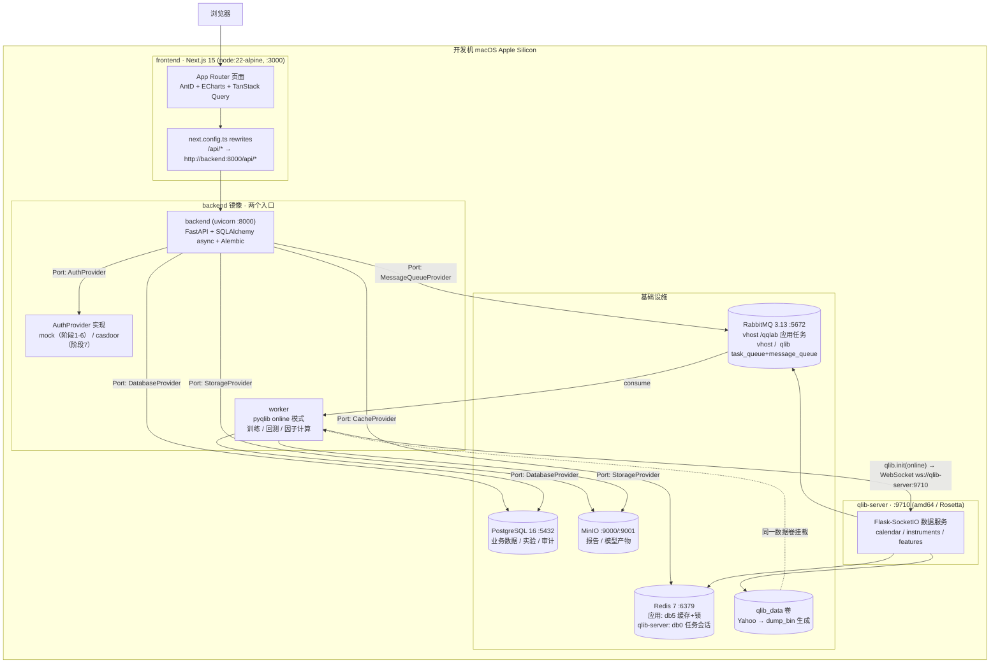
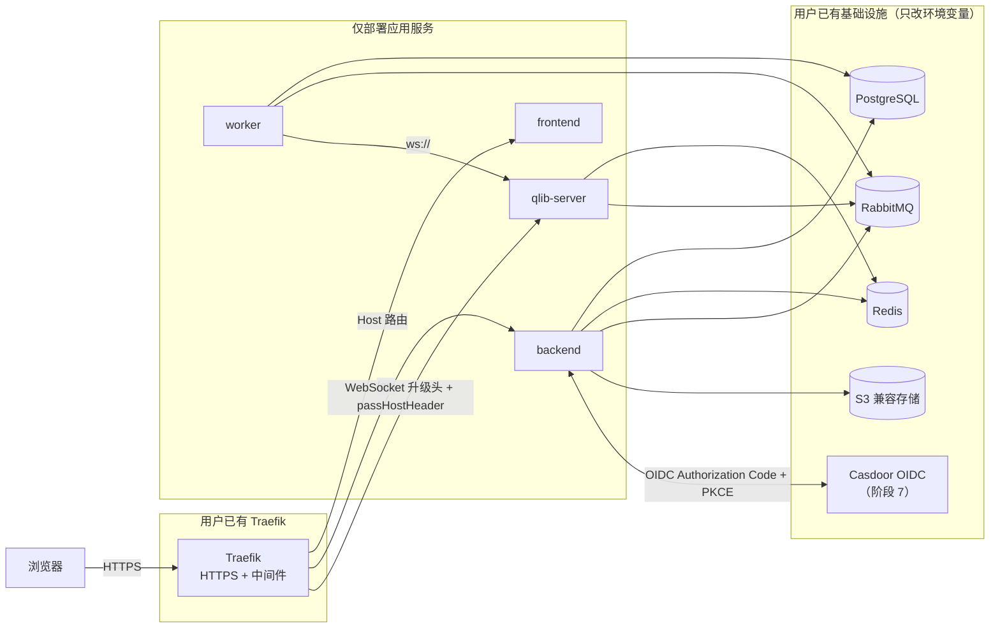
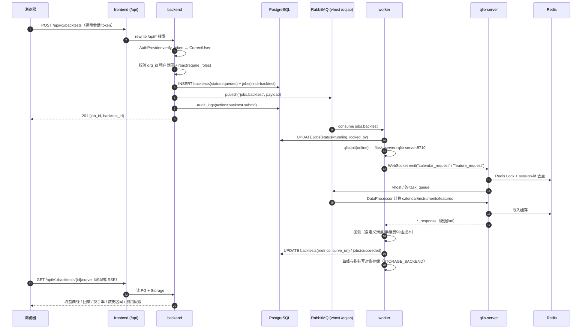
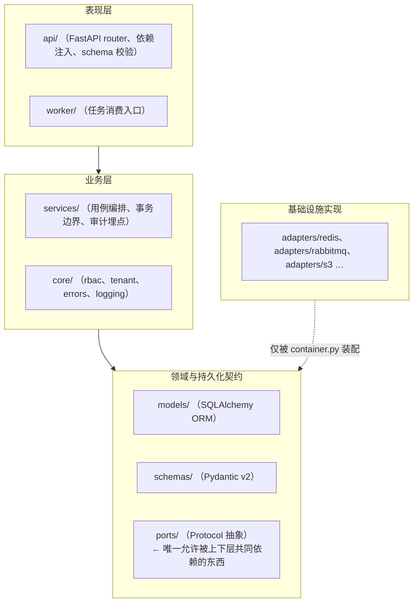
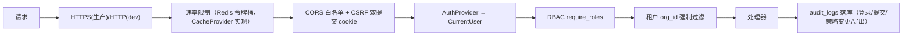

# 01 · 架构设计

## 1. 设计原则（硬约束的落地方式）

| 原则 | 落地方式 |
|------|----------|
| 端口与适配器（六边形架构） | `qqlab/ports/` 只放 Protocol/ABC，`qqlab/adapters/` 放实现，`qqlab/container.py` 按 `*_BACKEND` 环境变量装配 |
| 业务代码不碰基础设施 SDK | L1 架构约束测试（AST 扫描）强制执行，违规即测试失败 |
| Qlib 不进 Web 进程 | backend 镜像同一份代码两个入口：`uvicorn`（API）与 `qqlab-worker`（消费 RabbitMQ、`qlib.init` online 模式） |
| Qlib 硬依赖 Redis + RabbitMQ | 由 compose 提供；模式 B 指向用户已有实例；应用可与之共用，也可用 vhost/db 分离 |
| 认证先抽象后实现 | 阶段 1 就定 `AuthProvider` Port，Mock 与 Casdoor 两个 Adapter；`AUTH_PROVIDER` 切换 |
| 无硬编码地址 | 所有地址走 `pydantic-settings` 读环境变量；前端只用相对路径 `/api` |
| 应用层不感知反向代理 | 开发 compose 无 Traefik；Traefik labels 只在 `docker-compose.prod.yml` |

## 2. 服务拓扑（模式 A · 开发环境自包含）

### 服务清单

| 服务 | 镜像/构建 | 端口 | 说明 |
|------|-----------|------|------|
| `frontend` | 本地 `frontend/Dockerfile`（node:22-alpine） | 3000 | Next.js dev server，bind mount 源码热更新 |
| `backend` | 本地 `backend/Dockerfile`（python:3.12-slim + uv） | 8000 | FastAPI；`uvicorn qqlab.main:app` |
| `worker` | 同 `backend` 镜像 | — | `qqlab-worker` 入口；import qlib |
| `migrate` | 同 `backend` 镜像 | — | 一次性：`alembic upgrade head` |
| `qlib-server` | 本地 `qlib-server/Dockerfile` | 9710 | **硬依赖** Redis + RabbitMQ |
| `qlib-bootstrap` | 同 `qlib-server` 镜像 | — | 一次性：Yahoo 下载 + `dump_bin` |
| `postgres` | `postgres:16-alpine` | 5432 | |
| `redis` | `redis:7-alpine` | 6379 | 应用与 qlib-server 共用实例、分 db |
| `rabbitmq` | `rabbitmq:3.13-management-alpine` | 5672 / 15672 | 共用 broker、分 vhost |
| `minio` | `minio/minio` | 9000 / 9001 | |

> 开发环境不需要 Casdoor 容器，`AUTH_PROVIDER=mock`。

## 3. 模式 B · 复用现有基础设施

**两种模式的唯一差别**：`docker-compose.yml` 起全部依赖；`docker-compose.prod.yml` 用 `external: true` 网络 + 环境变量指向已有服务，应用镜像与代码完全一致。

**Qlib-Server 的硬依赖不可消除**：它内部用 Redis 维护客户端 session-id、用 `python-redis-lock` 防 IO 冲突、用 RabbitMQ 的 `task_queue`/`message_queue` 做数据任务分发。模式 B 下这两个地址仍然必填（`QLIB_SERVER_REDIS_HOST` / `QLIB_SERVER_QUEUE_HOST`），可以指向用户已有的 Redis/RabbitMQ，但**不能留空**。文档与 `/api/v1/system/info` 里都会显式提示这一点。

## 4. 关键时序：提交一次回测

## 5. 分层与依赖方向

依赖方向：`api → services → ports ← adapters`。`adapters` 反向实现 `ports`，由 `container.py` 在启动时装配 —— 这就是「业务代码只依赖抽象接口」的结构保证。

## 6. 数据流与隔离

| 资源 | 隔离方式 |
|------|----------|
| 业务数据（Postgres） | 每表 `org_id` 非空 + 仓库层强制 WHERE + 复合索引 `(org_id, id)`；L2 测试保证 |
| Qlib 数据目录 | `qlib_data/{org_id}/…` 卷内子目录；worker `qlib.init` 的 `provider_uri` 按 org 拼接 |
| 实验/模型目录 | 同上，`experiments/{org_id}/{project_id}/…` |
| 缓存 key | `qqlab:{org_id}:…` 前缀，避免跨租户缓存污染 |
| RabbitMQ | 应用任务走 vhost `/qqlab`，路由键带 `org_id` 头；qlib-server 独占 vhost `/` |
| 对象存储 | key 前缀 `{org_id}/…` |
| 策略可见性 | 默认 `private`；改 `public` 需二次确认接口（`POST /strategies/{id}/publish` + `confirm=true`） |

## 7. 安全与合规在架构上的位置

- 密钥全部来自环境变量（`.env` 已在 `.gitignore`），`.env.example` 只给占位符。
- 敏感操作（删除项目、策略公开、批量导出、修改系统配置）需 `confirm=true` 二次确认参数。
- 首页、注册页、报告页常驻风险提示；所有报告导出自动附加「数据区间 / 参数 / 费用假设 / 局限性 / 不构成投资建议」页脚。
