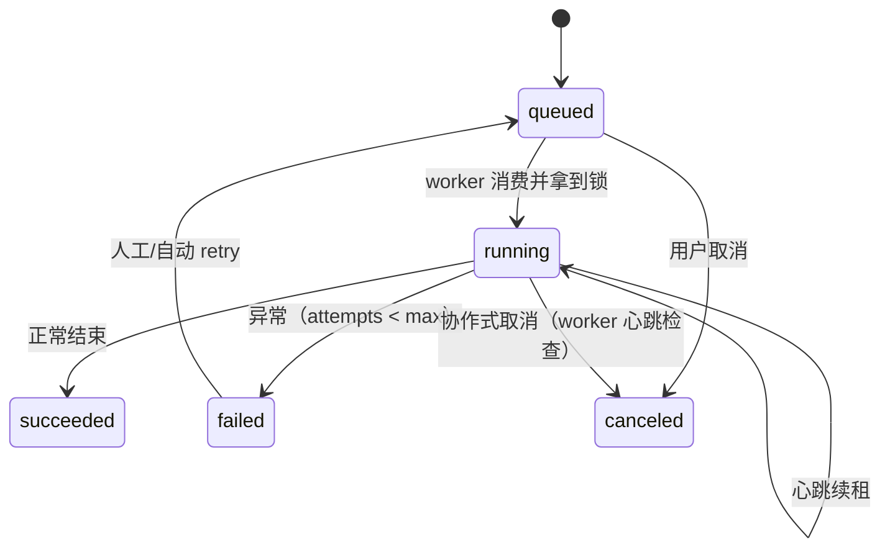
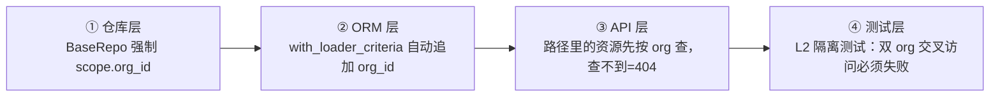

# 03 · 数据模型与多租户隔离

## 1. 实体关系图（ER）

> 图中 `ts` = `TIMESTAMPTZ`（统一 UTC），`uuid` = `UUID PRIMARY KEY`。

```mermaid
erDiagram
    organizations ||--o{ org_members : "has member"
    users ||--o{ org_members : "joins"
    organizations ||--o{ projects : "owns"
    users ||--o{ projects : "created_by"
    projects ||--o{ project_members : "has member"
    users ||--o{ project_members : "joins"

    organizations ||--o{ data_sources : "registers"
    data_sources ||--o{ data_licenses : "licensed by"
    data_sources ||--o{ datasets : "feeds"
    data_licenses ||--o{ datasets : "authorizes"
    projects ||--o{ datasets : "contains"

    projects ||--o{ factors : "defines"
    projects ||--o{ models : "defines"
    datasets ||--o{ models : "trains on"
    models ||--o{ training_runs : "produces"
    projects ||--o{ strategies : "defines"
    models ||--o{ strategies : "signals from"
    strategies ||--o{ backtests : "evaluated by"
    datasets ||--o{ backtests : "tested on"

    projects ||--o{ jobs : "spawns"
    jobs ||--o{ job_logs : "emits"
    jobs ||--o| training_runs : "records"
    jobs ||--o| backtests : "records"
    organizations ||--o{ audit_logs : "audits"
    users ||--o{ audit_logs : "acts"
    organizations ||--o{ system_configs : "configures"

    organizations {
        uuid id PK
        string slug UK
        string name
        string status
        jsonb settings
        ts created_at
        ts updated_at
    }
    users {
        uuid id PK
        string username UK
        string email UK
        string display_name
        string auth_provider
        string external_id
        string status
        ts last_login_at
        ts created_at
    }
    org_members {
        uuid id PK
        uuid org_id FK
        uuid user_id FK
        string status
        ts created_at
    }
    projects {
        uuid id PK
        uuid org_id FK
        string name
        text description
        string visibility
        string created_by
        ts created_at
        ts updated_at
    }
    project_members {
        uuid id PK
        uuid project_id FK
        uuid user_id FK
        string role
        ts created_at
    }
    data_sources {
        uuid id PK
        uuid org_id FK
        string name
        string kind
        string vendor
        text notes
        string status
        ts created_at
    }
    data_licenses {
        uuid id PK
        uuid org_id FK
        uuid data_source_id FK
        string scope
        string license_ref
        bool redistribution_allowed
        ts granted_at
        ts expires_at
        text evidence_uri
        string status
    }
    datasets {
        uuid id PK
        uuid org_id FK
        uuid project_id FK
        uuid data_source_id FK
        uuid license_id FK
        string name
        string qlib_region
        string freq
        date start_date
        date end_date
        int instrument_count
        text storage_uri
        string status
    }
    factors {
        uuid id PK
        uuid org_id FK
        uuid project_id FK
        string name
        text expression
        jsonb params
        int version
        string visibility
        string created_by
        ts created_at
    }
    models {
        uuid id PK
        uuid org_id FK
        uuid project_id FK
        string name
        string algo
        jsonb hyperparams
        jsonb training_config
        uuid dataset_id FK
        jsonb factor_snapshot
        string created_by
    }
    training_runs {
        uuid id PK
        uuid org_id FK
        uuid project_id FK
        uuid model_id FK
        uuid job_id FK
        jsonb metrics
        jsonb data_range
        text artifact_uri
        text code_hash
        ts started_at
        ts finished_at
    }
    strategies {
        uuid id PK
        uuid org_id FK
        uuid project_id FK
        string name
        uuid model_id FK
        jsonb signal_config
        bool is_public
        int version
        string created_by
        ts published_at
    }
    backtests {
        uuid id PK
        uuid org_id FK
        uuid project_id FK
        uuid strategy_id FK
        uuid dataset_id FK
        uuid job_id FK
        string benchmark
        jsonb split_config
        jsonb cost_config
        jsonb metrics
        jsonb data_range
        text curve_uri
        text limitations
        string created_by
    }
    jobs {
        uuid id PK
        uuid org_id FK
        uuid project_id FK
        string kind
        string status
        int priority
        jsonb payload
        int progress
        int attempts
        text locked_by
        text error
        text log_uri
        string requested_by
        ts queued_at
        ts started_at
        ts finished_at
    }
    job_logs {
        uuid id PK
        uuid job_id FK
        int seq
        string level
        text message
        ts created_at
    }
    audit_logs {
        uuid id PK
        uuid org_id FK
        uuid actor_user_id FK
        string actor_username
        string action
        string resource_type
        string resource_id
        string outcome
        jsonb detail
        text ip
        text request_id
        ts created_at
    }
    system_configs {
        uuid id PK
        uuid org_id FK
        string config_key
        jsonb value
        bool is_secret
        string updated_by
        ts updated_at
    }
```



**唯一不含 `org_id` 的表**：`users`（全局身份，跨组织复用）。所有**业务表** 100% 非空 `org_id` + `created_by`。
**刻意不建表的东西**：

| 需求 | 不建表的原因 |
|------|--------------|
| 登录会话 | 状态无关 JWT；PKCE 的 `state/nonce/verifier` 走 `CacheProvider`（TTL 10 分钟） |
| 限流计数 | `CacheProvider` 令牌桶 |
| 任务日志正文 | 大日志落对象存储 `logs/{org_id}/{job_id}.log`；`job_logs` 只存前 N 条关键事件用于时间线 |
| 合规文案（协议/风险提示） | **静态文件** `docs/legal/*.md`，通过 `/api/v1/legal/{code}` 返回 —— 防止租户改写风险提示 |
| 报告导出记录 | 作为 `jobs(kind=export)` + `audit_logs(action=export)`，避免重复建模 |

## 2. 核心表说明

### 2.1 租户与身份

- `organizations`：租户边界。开发阶段固定 `id = 'dev-org'`（`slug = 'dev'`），由 Alembic seed 迁移写入。
- `users`：`auth_provider ∈ {mock, casdoor}` + `external_id`（Casdoor 的 sub）构成唯一键，保证阶段 7 切换后老数据可归属。
- `org_members.roles`：`text[]`，取值 `admin | researcher | viewer | auditor`。Mock 阶段 `dev-user` 同时是 `admin + researcher`。

### 2.2 数据与授权台账

- `data_sources`：数据源登记（**平台不内置未授权行情数据**）。
- `data_licenses`：授权台账，字段覆盖「谁授权、授权范围、是否允许再分发、有效期、证据文件」。`datasets.license_id` 强制非空 —— 没有台账记录就不能创建数据集（服务层校验）。
- `datasets`：记录 `qlib_region / freq / start_date / end_date / instrument_count / storage_uri`，回测与报告都要回显这些元信息。

### 2.3 研究链路

`factors → models → strategies → backtests`，每一步都保留**输入快照**（`models.factor_snapshot`、`strategies.signal_config`、`backtests.cost_config`），保证结果可复现、可解释。

- `models.training_config`：训练切分（train/valid/test 日期）、模型参数、随机种子。
- `strategies.signal_config`：TopK、丢弃规则、空仓处理、信号过滤 —— 是「策略」的唯一事实源。
- `backtests.cost_config`（**必须显式**）：

```json
{
  "commission_rate": 0.0005,
  "min_commission": 5.0,
  "slippage": {"type": "fixed_bp", "value": 10},
  "impact_cost": {"type": "linear", "rate_per_million": 0.0001},
  "settlement_fee": 0.00002,
  "stamp_duty_sell": 0.0005
}
```
- `backtests.data_range`：`{start, end, freq, benchmark, source_dataset_id, generated_at}`。
- `backtests.limitations`：自动生成的局限性说明（数据区间、未考虑因素、费用假设为静态模型等），报告导出时强制展示。

### 2.4 任务执行

`jobs` 是统一的任务表，`kind ∈ {dataset_import, factor_compute, train, backtest, export}`，状态机：



- 幂等：`payload_hash + org_id` 唯一，重复提交返回已有 job（可配置）。
- 心跳：`jobs.heartbeat_at` + `CacheProvider` 锁 TTL，worker 崩溃后锁过期 → 任务重新投递。
- 取消：写 `status=canceled` 标志，worker 在每个检查点轮询（协作式），不强杀进程。

## 3. 租户隔离的四道防线



1. **仓库层**：`BaseRepo(org: OrgScope)`，构造查询时 `select(T).where(T.org_id == org.id)`；子查询、聚合、更新同样走仓库，service 层不直接写 `select`。
2. **ORM 层**：`before_execute` 钩子为所有带 `org_id` 列的模型追加条件，作为兜底（防止有人绕过仓库）。
3. **API 层**：`GET /api/v1/projects/{id}` 用 `org + id` 复合条件查；跨 org 访问返回 **404**（不泄露存在性），权限不足返回 403。
4. **测试层**：CI 必跑，任何绕过都会被抓住。

### 派生 key 的租户前缀

| 资源 | 前缀 |
|------|------|
| 缓存 | `qqlab:{org_id}:...` |
| 分布式锁 | `lock:{org_id}:{resource}:{id}` |
| 对象存储 key | `{org_id}/{project_id}/{yyyy}/{mm}/...` |
| Qlib 数据目录 | `/qlib_data/{org_id}/...` |
| 实验/模型目录 | `/experiments/{org_id}/{project_id}/...` |
| 日志 | `logs/{org_id}/{job_id}.log` |

## 4. 索引与约束（关键项）

```sql
-- 租户过滤命中
CREATE INDEX idx_projects_org        ON projects (org_id, created_at DESC);
CREATE INDEX idx_jobs_org_status     ON jobs (org_id, status, queued_at DESC);
CREATE INDEX idx_backtests_org       ON backtests (org_id, created_at DESC);
CREATE INDEX idx_audit_org_time      ON audit_logs (org_id, created_at DESC);
CREATE INDEX idx_audit_actor         ON audit_logs (org_id, actor_user_id, created_at DESC);
CREATE INDEX idx_audit_action        ON audit_logs (org_id, action, created_at DESC);

-- 唯一性
ALTER TABLE projects     ADD CONSTRAINT uq_project_name_per_org UNIQUE (org_id, name);
ALTER TABLE org_members  ADD CONSTRAINT uq_member UNIQUE (org_id, user_id);
ALTER TABLE factors      ADD CONSTRAINT uq_factor UNIQUE (org_id, project_id, name, version);
ALTER TABLE system_configs ADD CONSTRAINT uq_cfg UNIQUE (org_id, config_key);
ALTER TABLE users        ADD CONSTRAINT uq_user_ext UNIQUE (auth_provider, external_id);

-- 授权台账强约束：创建数据集必须带有效 license
ALTER TABLE datasets ALTER COLUMN license_id SET NOT NULL;

-- 硬删除改为软删除 + 审计：所有业务表带 deleted_at（图中省略，阶段 2 统一加）
```

## 5. 与阶段的对应

| 表 | 首次出现阶段 |
|----|--------------|
| organizations / users / org_members / system_configs | 阶段 2 |
| projects / project_members / audit_logs / jobs / job_logs | 阶段 2–3（jobs 阶段 3） |
| data_sources / data_licenses / datasets | 阶段 4 |
| factors | 阶段 4 |
| models / training_runs / strategies / backtests | 阶段 5 |

全部表在阶段 2 就一次性建好（一张迁移），后续阶段只加列 —— 避免多租户字段后补的迁移风险。
