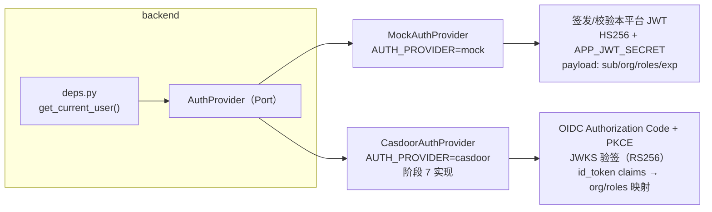

# 04 · API 列表 · 认证抽象层 · 权限模型

## 1. API 总览

- 统一前缀 `/api/v1`；前端一律用相对路径 `/api/v1/...`（Next.js rewrite 转发到 backend）。
- 统一响应体：`{ "code": 0, "message": "ok", "data": ..., "request_id": "..." }`；错误 `code` 为业务码，HTTP 状态码遵循语义。
- 除 `/health*`、`/auth/*`、`/legal/*`、`/system/info` 外，**全部要求会话**；所有业务接口隐式携带 `org_id`（来自 `CurrentUser`，**不接受**请求体传 `org_id`）。
- 权限列：`A`=admin，`R`=researcher，`V`=viewer，`U`=auditor。

### 1.1 认证与用户上下文

| Method | Path | 说明 | 权限 |
|--------|------|------|------|
| GET | `/api/v1/auth/login` | 返回 `{"url": ...}`；mock 返回 `/api/v1/auth/mock/enter` | 公开 |
| GET | `/api/v1/auth/callback?code=&state=` | OIDC 回调，发会话 cookie，重定向 `/` | 公开 |
| GET | `/api/v1/auth/logout` | 返回登出跳转地址并清 cookie | 登录 |
| POST | `/api/v1/auth/mock/enter` | **仅 `AUTH_PROVIDER=mock`**：生成 dev 会话（可选 `profile=admin\|researcher\|viewer\|auditor`） | 公开 |
| GET | `/api/v1/me` | `CurrentUser`（user_id/username/email/org_id/roles/provider） | 登录 |
| GET | `/api/v1/me/permissions` | 当前用户在当前 org 的权限点列表 | 登录 |

### 1.2 组织与系统管理

| Method | Path | 说明 | 权限 |
|--------|------|------|------|
| GET | `/api/v1/orgs/current` | 当前组织信息 | 登录 |
| GET | `/api/v1/admin/members` | 成员列表 | A |
| POST | `/api/v1/admin/members` | 添加成员/改角色 | A |
| DELETE | `/api/v1/admin/members/{user_id}?confirm=true` | 移除成员（二次确认） | A |
| GET | `/api/v1/admin/config` | 系统配置（secret 自动脱敏） | A |
| PATCH | `/api/v1/admin/config/{key}?confirm=true` | 修改配置（二次确认 + 审计） | A |
| GET | `/api/v1/system/info` | 版本、后端开关状态、**Qlib-Server Redis/RabbitMQ 依赖提示** | 公开 |
| GET | `/api/v1/health/live` `/ready` | 存活/就绪（就绪检查 DB + MQ + Cache） | 公开 |

### 1.3 项目管理

| Method | Path | 说明 | 权限 |
|--------|------|------|------|
| GET | `/api/v1/projects` | 列表（按 org 过滤） | 登录 |
| POST | `/api/v1/projects` | 创建 | A/R |
| GET | `/api/v1/projects/{id}` | 详情 | 登录 |
| PATCH | `/api/v1/projects/{id}` | 更新 | A/R |
| DELETE | `/api/v1/projects/{id}?confirm=true` | 删除（二次确认 + 审计） | A |
| GET/POST/DELETE | `/api/v1/projects/{id}/members` | 项目成员 | A/R |
| POST | `/api/v1/projects/{id}/visibility?confirm=true` | 私有↔公开切换（**必须二次确认**） | A |

### 1.4 数据管理

| Method | Path | 说明 | 权限 |
|--------|------|------|------|
| GET/POST | `/api/v1/data-sources` | 数据源登记 | 登录 / A/R |
| GET/PATCH/DELETE | `/api/v1/data-sources/{id}` | 详情/更新/删除 | … |
| GET/POST | `/api/v1/data-licenses` | **授权台账**（无台账不可建数据集） | 登录 / A |
| GET/PATCH | `/api/v1/data-licenses/{id}` | 台账详情/续期 | 登录 / A |
| GET/POST | `/api/v1/datasets` | 数据集列表/创建 | 登录 / A/R |
| POST | `/api/v1/datasets/{id}/import` | 提交导入任务 → `jobs(kind=dataset_import)` | A/R |
| GET | `/api/v1/datasets/{id}/preview?limit=&offset=` | 数据预览（按 org 过滤） | 登录 |
| GET | `/api/v1/datasets/{id}/instruments` | 标的列表 | 登录 |
| GET | `/api/v1/datasets/{id}/calendar?start=&end=` | 交易日历 | 登录 |

### 1.5 因子与表达式

| Method | Path | 说明 | 权限 |
|--------|------|------|------|
| GET/POST | `/api/v1/factors` | 列表/创建（`visibility=private\|org\|public`） | 登录 / A/R |
| GET/PATCH/DELETE | `/api/v1/factors/{id}` | 详情/更新（改表达式 → version+1）/删除 | A/R |
| POST | `/api/v1/factors/validate` | 表达式静态校验（不落库） | 登录 |
| POST | `/api/v1/factors/{id}/compute?confirm=true` | 提交因子计算任务 | A/R |
| POST | `/api/v1/factors/{id}/publish?confirm=true` | 公开（二次确认 + 审计） | A |
| GET | `/api/v1/factors/{id}/preview` | 因子值预览 | 登录 |

### 1.6 模型与训练

| Method | Path | 说明 | 权限 |
|--------|------|------|------|
| GET/POST | `/api/v1/models` | 模型定义（算法 + 超参 + 数据集 + 因子集合） | 登录 / A/R |
| GET/PATCH/DELETE | `/api/v1/models/{id}` | 详情/更新/删除 | … |
| GET | `/api/v1/models/catalog` | 可用算法目录（由 worker 探测） | 登录 |
| POST | `/api/v1/train-jobs` | 提交训练 → `jobs(kind=train)` | A/R |
| GET | `/api/v1/train-jobs` `/train-jobs/{id}` | 列表/详情（状态、指标、数据区间） | 登录 |
| GET | `/api/v1/train-jobs/{id}/logs?since=` | 训练日志（分页/增量） | 登录 |

### 1.7 策略与回测

| Method | Path | 说明 | 权限 |
|--------|------|------|------|
| GET/POST | `/api/v1/strategies` | 策略列表/创建（**默认私有**） | 登录 / A/R |
| GET/PATCH/DELETE | `/api/v1/strategies/{id}` | 详情/更新（版本+1）/删除 | A/R |
| POST | `/api/v1/strategies/{id}/publish?confirm=true` | 公开，**必须二次确认** + 审计 | A |
| POST | `/api/v1/backtests` | 提交回测 → `jobs(kind=backtest)` | A/R |
| GET | `/api/v1/backtests` `/backtests/{id}` | 列表/详情（含 `cost_config`/`data_range`/`limitations`） | 登录 |
| GET | `/api/v1/backtests/{id}/curve` | 收益曲线 / 基准曲线（降采样） | 登录 |
| GET | `/api/v1/backtests/{id}/metrics` | 年化、Sharpe、最大回撤、换手率、卡玛… | 登录 |
| GET | `/api/v1/backtests/{id}/positions` | 持仓明细（分页） | 登录 |
| POST | `/api/v1/backtests/{id}/export?format=pdf\|xlsx&confirm=true` | 导出报告 → `jobs(kind=export)` + 审计 | A/R |

`POST /api/v1/backtests` 请求体（**费用三件套必填**）：

```json
{
  "project_id": "…",
  "strategy_id": "…",
  "dataset_id": "…",
  "benchmark": "SH000300",
  "split": {"train": ["2018-01-01","2020-12-31"], "test": ["2021-01-01","2023-12-31"]},
  "cost": {
    "commission_rate": 0.0005,
    "min_commission": 5.0,
    "slippage": {"type": "fixed_bp", "value": 10},
    "impact_cost": {"type": "linear", "rate_per_million": 0.0001}
  },
  "topk": 50,
  "repeat": 1
}
```

### 1.8 任务中心

| Method | Path | 说明 | 权限 |
|--------|------|------|------|
| GET | `/api/v1/jobs?kind=&status=&project_id=&page=` | 任务列表 | 登录 |
| GET | `/api/v1/jobs/{id}` | 详情（进度、错误、日志地址） | 登录 |
| GET | `/api/v1/jobs/{id}/logs?since_seq=` | 增量日志（轮询或 SSE） | 登录 |
| POST | `/api/v1/jobs/{id}/cancel?confirm=true` | 取消 | A/R（发起人） |
| POST | `/api/v1/jobs/{id}/retry?confirm=true` | 重试 | A/R（发起人） |
| GET | `/api/v1/jobs/stream` | SSE 任务状态推送（可选，阶段 5） | 登录 |

### 1.9 审计与合规

| Method | Path | 说明 | 权限 |
|--------|------|------|------|
| GET | `/api/v1/audit-logs?actor=&action=&resource=&from=&to=&page=` | 审计查询 | A/U |
| GET | `/api/v1/audit-logs/export?format=csv&confirm=true` | 审计导出（记审计） | A/U |
| GET | `/api/v1/legal/terms` `/risk` `/disclaimer` | 用户协议 / 风险提示 / 免责声明（静态） | 公开 |
| GET | `/api/v1/legal/meta` | 版本号与生效日期 | 公开 |

**必记审计的动作**（`action` 枚举）：
`auth.login` `auth.logout` `auth.login_failed` · `project.create/update/delete` `project.member.add/remove` `project.visibility.change` · `data_source.create` `data_license.create/revoke` `dataset.import` · `factor.create/update/publish` · `model.create/update` `train.submit` · `strategy.create/update/publish` · `backtest.submit` `backtest.export` · `job.cancel/retry` · `admin.config.update` `admin.member.role_change`

## 2. 认证抽象层（阶段 1 就必须做对）

### 2.1 `CurrentUser` —— 全系统唯一的用户上下文

```python
# qqlab/ports/auth.py
from dataclasses import dataclass, field
from enum import StrEnum

class Role(StrEnum):
    ADMIN = "admin"
    RESEARCHER = "researcher"
    VIEWER = "viewer"
    AUDITOR = "auditor"

@dataclass(frozen=True, slots=True)
class CurrentUser:
    user_id: str
    username: str
    org_id: str
    roles: tuple[Role, ...] = ()
    email: str | None = None
    display_name: str | None = None
    is_authenticated: bool = True
    provider: str = "mock"          # "mock" | "casdoor"

    @property
    def is_admin(self) -> bool: ...
    def has_any(self, *roles: Role) -> bool: ...
```

- `org_id` **必须**由认证层给出，业务代码永远不从请求参数读 org。
- 会话与 `CurrentUser` 一一对应；Mock 阶段固定 `dev-user / dev-org`。

### 2.2 `AuthProvider` Port —— 五个方法

```python
from typing import Protocol, runtime_checkable

@runtime_checkable
class AuthProvider(Protocol):
    name: str  # "mock" | "casdoor"

    def get_login_url(self, state: str, redirect_to: str) -> str:
        """返回登录跳转地址。mock 返回站内地址；casdoor 返回 OIDC authorize URL（含 PKCE code_challenge）。"""

    async def handle_callback(self, code: str, state: str) -> CurrentUser:
        """处理 OIDC 回调（mock: code 即 profile 名）。换取身份、建/查用户与 org_members、返回 CurrentUser。"""

    async def verify_token(self, token: str) -> CurrentUser | None:
        """校验会话令牌，失败返回 None（调用方转 401）。mock 校验本平台签发的 JWT；casdoor 走 JWKS。"""

    def get_logout_url(self, redirect_to: str) -> str:
        """返回登出地址。mock 返回站内；casdoor 返回 end_session_endpoint。"""

    async def healthcheck(self) -> bool:
        """就绪检查用：IdP 是否可达。"""
```

> 比题目要求多了 `healthcheck()`，用于 `/ready` 与模式 B 的启动探针。

### 2.3 两个实现的分工



| 维度 | `MockAuthProvider` | `CasdoorAuthProvider` |
|------|--------------------|------------------------|
| 阶段 | 1–6（开发默认） | 7 |
| `get_login_url` | `/api/v1/auth/mock/enter?profile=admin` | `{issuer}/login/oauth/authorize?client_id&redirect_uri&scope&state&code_challenge` |
| `handle_callback` | 不需要（直接 `enter`） | 换 token → 解 `id_token` → upsert `users`/`org_members` → 签发本平台会话 |
| `verify_token` | 校验本平台 HS256 JWT | 校验 Casdoor JWT（RS256 / JWKS 缓存于 CacheProvider） |
| 会话载体 | HttpOnly + Secure(生产) + SameSite=Lax cookie `qqlab_session` | **同样**是本平台会话 cookie（IdP 令牌只在后端留存） |
| roles 来源 | 环境变量 `MOCK_USER_ROLES` 或 profile 参数 | Casdoor claim `roles`（`CASDOOR_ROLE_CLAIM`，可配映射） |
| 需要新增表 | 无 | 无（`users.auth_provider+external_id` 已预留） |

**为什么 Casdoor 模式下也自己签发会话**：前端永远只认 `useCurrentUser()` 与 `/api/v1/me`，不需要引入 Casdoor SDK，也不需要处理 token 刷新；阶段 7 切换时前端零改动。

### 2.4 后端取用户的唯一入口

```python
# qqlab/api/deps.py
async def get_current_user(request: Request) -> CurrentUser: ...
def require_roles(*roles: Role) -> Callable[..., Awaitable[CurrentUser]]: ...
async def get_org_scope(user: CurrentUser = Depends(get_current_user)) -> OrgScope: ...
async def require_confirmation(confirm: bool) -> None:   # confirm != True -> 400 + 审计
```

规则：
1. 所有业务路由 `Depends(get_current_user)`，**禁止**在路由里读 `Authorization` header 或解 JWT。
2. 所有业务路由 `Depends(get_org_scope)`，服务层只接受 `OrgScope`。
3. 需要角色的用 `Depends(require_roles(Role.ADMIN))`，多个角色是 OR 语义。
4. 敏感操作加 `Depends(require_confirmation)`。

### 2.5 前端唯一入口

```tsx
// src/contexts/AuthContext.tsx  →  包住全站
// src/hooks/useCurrentUser.ts
export function useCurrentUser(): {
  user: CurrentUser | null;
  isLoading: boolean;
  login(): Promise<void>;      // fetch('/api/v1/auth/login') → 跳 url
  logout(): Promise<void>;
  can(...roles: Role[]): boolean;
}
```

- 业务组件只 import `useCurrentUser()`；**禁止**直接调用 Casdoor SDK 或读 cookie。
- 会话失效（401）统一由 `lib/api.ts` 拦截 → 跳登录页。

### 2.6 阶段 7 只需改三处

```
1. 实现 CasdoorAuthProvider（骨架 + TODO 已在阶段 1 提交）
2. AUTH_PROVIDER=casdoor
3. 填 CASDOOR_ISSUER / CLIENT_ID / CLIENT_SECRET / REDIRECT_URI / ROLE_CLAIM
```
业务代码、数据库表、权限逻辑、前端 —— **零改动**。

## 3. RBAC 权限矩阵

| 权限点 | admin | researcher | viewer | auditor |
|--------|:----:|:----------:|:------:|:-------:|
| 查看项目/数据集/因子/回测 | ✅ | ✅ | ✅ | ✅ |
| 创建/修改项目、因子、模型、策略 | ✅ | ✅ | ❌ | ❌ |
| 提交训练/回测/因子计算任务 | ✅ | ✅ | ❌ | ❌ |
| 取消/重试自己发起的任务 | ✅ | ✅ | ❌ | ❌ |
| 删除资源、修改系统配置 | ✅ | ❌ | ❌ | ❌ |
| 公开策略/因子（二次确认） | ✅ | ❌ | ❌ | ❌ |
| 成员与角色管理 | ✅ | ❌ | ❌ | ❌ |
| 查看审计日志 | ✅ | ❌ | ❌ | ✅ |
| 导出审计日志 | ✅ | ❌ | ❌ | ✅ |
| 导出回测报告 | ✅ | ✅ | ❌ | ✅ |

实现要点：
- `core/rbac.py` 里是**声明式权限表**（`PERMISSIONS: dict[str, set[Role]]`），路由上写权限点名而非硬编码角色，方便后续加角色。
- 权限校验在**第一阶段就实现**，Mock 用户默认 `admin+researcher`，另提供 `viewer` / `auditor` 两个 mock profile 供 UI 直接切换验证。
- 「跨租户访问」永远返回 404，「权限不足」返回 403 —— 两者不可混淆。

## 4. 会话与安全细节

| 项 | 决策 |
|----|------|
| 会话载体 | HttpOnly Cookie `qqlab_session`（SameSite=Lax；生产 `Secure`），值为本平台 JWT |
| JWT | HS256，`APP_JWT_SECRET` 注入，`exp=8h`，`jti` 存 CacheProvider 支持主动吊销 |
| CSRF | 双提交 cookie：非 `GET` 请求必须带 `X-CSRF-Token`（`lib/api.ts` 自动附加） |
| 限流 | `CacheProvider` 令牌桶：登录 5/min/IP，写接口 120/min/用户，读接口 600/min/用户 |
| CORS | `CORS_ALLOW_ORIGINS` 白名单；生产仅 `https://…`；`allow_credentials=true` |
| PKCE state | `CacheProvider` 存 `state → {verifier, redirect_to}`，TTL 10min，一次性 |
