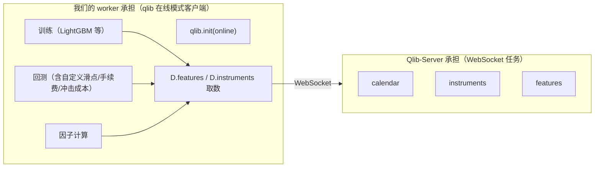
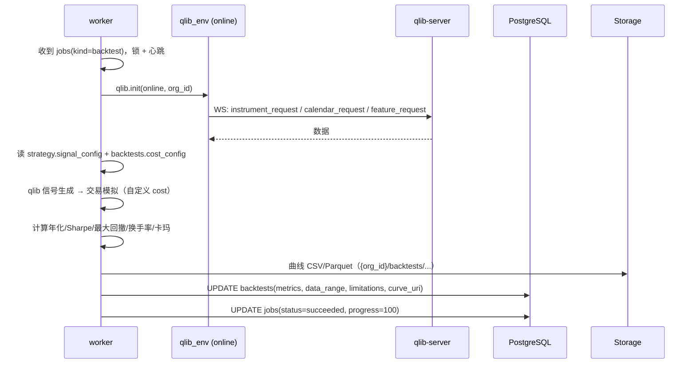

# 06 · Qlib-Server 集成设计（含版本兼容矩阵）

> 本文件的结论基于对 `microsoft/qlib-server` 源码、`docs/server.rst`、`docs/client.rst`、`docker_support/*` 与 `microsoft/qlib` 的 `qlib/data/client.py`、`qlib/__init__.py`、`pyproject.toml` 的实际核对，不含推测。

## 1. 事实核对：Qlib-Server 到底做什么

| 官方文档原话/源码 | 结论 |
|-------------------|------|
| 「the server will … submit these parsed tasks to a pipe. Qlib use RabbitMQ as this pipe. The tasks will be published to a channel `task_queue`」 | 任务分发走 RabbitMQ |
| 「the server will use Redis to maintain the session-ids of those clients」+ `python-redis-lock` | 会话去重 + 分布式锁走 Redis |
| 「it currently supports the three types of tasks … Calendar, Instruments, Features」 | **只做数据服务**：日历、标的、特征 |
| `qlib/data/client.py`：`socketio.Client().connect(f"ws://{host}:{port}")` → `emit("<type>_request")` → `wait()` → `disconnect()` | 客户端每次请求建一次 WS，事件名 `calendar_request/response`、`instrument_request/response`、`feature_request/response` |
| qlib-server 仓库内**没有**训练/回测相关代码 | **训练与回测必须由我们自己的 qlib 客户端进程执行** |
| `qlib_server/utils.py`：`redis.StrictRedis(host=C.redis_host, port=C.redis_port, db=C.redis_task_db)` | **不支持 Redis 密码**，也不支持 TLS → 共用实例必须免密，或给它单开一个实例（风险 R11） |
| `qlib_server/utils.py`：`pika.ConnectionParameters(host, credentials=…, heartbeat=0)` | **只指定 host 与账号密码** → 固定走 vhost `/`、端口 5672；模式 B 下必须保证该账号在默认 vhost 上有权限（应用队列用 `/qqlab` 分离） |

**由此得出的核心架构结论**（与需求里「通过 WebSocket 提交任务」的关系）：



- **合规**：Qlib 不被嵌入 Web 进程 —— backend 只写 `jobs` 表并发消息；worker 才 import qlib。
- **WebSocket 提交任务**：由 worker 的 qlib 客户端完成；backend 只负责把任务投递到应用自己的 MQ。

## 2. 版本兼容矩阵（锁定依据）

### 2.1 关键事实

| 项 | 核对结果 |
|----|----------|
| PyPI 包名 | **`pyqlib`** 是官方包；PyPI 上的 `qlib` 是被抢注的空包（0.0.2.dev20），**绝不能装** |
| 最新 pyqlib | `0.9.7`，`requires-python >=3.8`，classifiers 覆盖 3.8–3.12 |
| pyqlib 的 client extra | `python-socketio<6`、`tables` |
| qlib-server 官方 Dockerfile 写死 | `python-engineio==3.11.2 python-socketio==4.4.0 flask-socketio==3.1.2`，随后 `pip install git+https://github.com/microsoft/qlib` |
| qlib-server `setup.py` | `gevent<23`、`Flask>=1.0.2`、`pika>=0.12`、`redis>=3.0.1`、`python-redis-lock`、`wsproto<1.2`，要求已装 qlib `>=0.4.0` |
| qlib-server `config_template.yaml` | `client_version: '>=0.4.0'`、`server_version: '>=0.4.0'` |
| 官方基础镜像 `continuumio/miniconda3:4.8.2` | Docker Hub 上**只有 amd64 一个 image**（2020-03 推送）→ Apple Silicon 必须仿真或换基座 |
| Engine.IO 协议代际 | socketio 4.x ↔ engineio 3.x（EIO=3）；socketio 5.x ↔ engineio 4.x（EIO=4）—— **两边不兼容，握手直接失败** |

### 2.2 锁定方案

| 组件 | 版本 | 位置 |
|------|------|------|
| `python-socketio`（**server 端**） | `==4.4.0` | `qlib-server/Dockerfile` |
| `python-engineio`（**server 端**） | `==3.11.2` | `qlib-server/Dockerfile` |
| `flask-socketio`（server 端） | `==3.1.2` | `qlib-server/Dockerfile` |
| `python-socketio`（**client 端 / worker**） | `==4.6.1`（4.x 线最后一版，EIO=3） | `backend/pyproject.toml` + `uv.lock` |
| `python-engineio`（client 端） | `==3.14.2`（3.x 线最后一版） | 同上 |
| `pyqlib` | `==0.9.7`（**阶段 3 实测确认**，不通则降级到 `0.8.x`） | `backend/pyproject.toml` |
| `qlib-server` | 锁定官方仓库 commit SHA，不用 `main` | `qlib-server/Dockerfile` |

**验证方法（阶段 3 第一步，30 分钟内出结论）**：
1. `pip install python-socketio==4.6.1 python-engineio==3.14.2 pyqlib==0.9.7`，脚本直连 `ws://localhost:9710` emit `calendar_request`，看是否收到 `calendar_response`。
2. 若握手失败 → 逐档排查：client 降到 `socketio==4.4.0/engineio==3.11.2`（与 server 完全一致）。
3. 若 `pyqlib 0.9.7` 与 server 数据协议不兼容 → 降 `pyqlib` 到 server Dockerfile 当年对应的版本区间（`0.8.x`）。

> 风险 R3、R4 详细缓解见 [08-risks-and-roadmap.md](./08-risks-and-roadmap.md)。

## 3. worker 的 qlib 初始化（避免 NFS 陷阱）

官方文档的标准 online 配置长这样：

```yaml
calendar_provider:   {class: LocalCalendarProvider, kwargs: {remote: true}}
feature_provider:    {class: LocalFeatureProvider,  kwargs: {remote: true}}
expression_provider: LocalExpressionProvider
instrument_provider: ClientInstrumentProvider
dataset_provider:    ClientDatasetProvider
provider:            ClientProvider
expression_cache: null
dataset_cache: null
calendar_cache: null
provider_uri: 127.0.0.1:/          # NFS 地址
mount_path: /data/stock_data/qlib_data
auto_mount: true
flask_server: 127.0.0.1
flask_port: 9710
region: cn
```

**NFS 问题**：`auto_mount: true` 会在容器里跑 `sudo mount.nfs`，Docker 中要么给 `--privileged`，要么失败。
核对 `qlib/__init__.py` 的逻辑后，我们采用**不走 NFS** 的路径：

| 配置 | 我们的取值 | 理由 |
|------|-----------|------|
| `provider_uri` | `/qlib_data/{org_id}`（**本地路径**） | `C.dpm.get_uri_type()` 判为 `LOCAL_URI`，直接跳过挂载 |
| `mount_path` | 与 `provider_uri` 相同 | 与数据卷挂载点一致 |
| `auto_mount` | `false` | 路径存在则只打 warning，不执行 mount |
| `flask_server` / `flask_port` | `QLIB_SERVER_WS_URL` 解析出的 host/9710 | 环境变量注入 |
| 数据卷 | `qlib_data` 命名卷同时挂到 `qlib-server:/qlib_data` 与 `worker:/qlib_data` | 共享数据目录，替代 NFS |

> **前提**：`LocalCalendarProvider/LocalFeatureProvider(remote=True)` 仍从 WS 取数，本地卷只作兜底。**阶段 3 必须实测**确认「不挂 NFS、仅共享卷」能跑通 `D.instruments()` 与 `D.features()`；若实测表明必须 NFS，则回退方案是 compose 给 worker 加 `cap_add: SYS_ADMIN` + `auto_mount: true`，或改用宿主机预挂载。（风险 R4）

### `worker/qlib_env.py`（全仓唯一 import qlib 的文件）

```python
# 伪代码，阶段 3 落盘
def build_qlib_config(org_id: str, settings: Settings) -> dict:
    data_root = f"{settings.QLIB_DATA_ROOT}/{org_id}"
    host, port = parse_ws(settings.QLIB_SERVER_WS_URL)      # ws://qlib-server:9710
    return {
        "calendar_provider":   {"class": "LocalCalendarProvider", "kwargs": {"remote": True}},
        "feature_provider":    {"class": "LocalFeatureProvider",  "kwargs": {"remote": True}},
        "expression_provider": "LocalExpressionProvider",
        "instrument_provider": "ClientInstrumentProvider",
        "dataset_provider":    "ClientDatasetProvider",
        "provider":            "ClientProvider",
        "expression_cache": None, "dataset_cache": None, "calendar_cache": None,
        "provider_uri": data_root, "mount_path": data_root, "auto_mount": False,
        "flask_server": host, "flask_port": int(port),
        "region": settings.QLIB_REGION,
    }

@contextmanager
def qlib_online(org_id: str, settings: Settings):
    """进程级：qlib 是全局单例，同一 worker 进程内串行执行、按 org 切换配置。"""
    qlib.init(**build_qlib_config(org_id, settings))
    try:
        yield
    finally:
        ...  # 清理缓存 H.clear()
```

**并发约束（重要）**：qlib 的 `C` 配置与缓存是进程级单例 → **同一 worker 进程内不能并发跑不同 org 的任务**。因此 `QLIB_WORKER_CONCURRENCY=1`（每个 worker 串行），并行靠**横向扩容 worker 副本数**（`deploy.replicas`）实现。这一条写进运维文档。

## 4. 训练与回测的执行链



### 费用与滑点：必须自定义，不能用默认

qlib 的回测成本由 `qconf`（`qlib/contrib/model` 无关，实际在 `qlib/contrib/backtest/` 与 `qlib/utils/` 的 config）驱动。**阶段 5 实现前需再次核对当前版本的确切字段名**（qlib 的 `backtest` 配置键在版本间有变动），设计上我们保证：

1. `backtests.cost_config` 三件套**在 API 层即为必填**，缺失返回 422。
2. worker 把 `cost_config` 显式展开成 qlib 回测配置的 `open_cost / close_cost / trade_cost / slippage` 等字段——**不使用 qlib 默认值**；转换函数放 `worker/handlers/backtest.py`，并有单测断言「自定义值 100% 透传」。
3. 回测结果的 `metrics` 里回写 `cost_config` 的副本，报告里展示的费用假设与实际执行的完全一致。
4. 若核对后发现 qlib 的成本模型无法表达 `impact_cost`（冲击成本），则在我们自己的交易模拟层叠加 `impact = rate_per_million × 成交额`，并在 `limitations` 中说明。

> 这一条是硬约束，**阶段 3/5 各做一次核对**，核对结论追加到本文件。

### 结果必须标注（报告页脚固定输出）

- 数据区间 `data_range.start ~ end`、频率 `freq`、基准 `benchmark`
- 数据来源与授权（`data_licenses.license_ref`）
- 参数快照（`signal_config` / 模型超参）
- 费用假设（`cost_config` 全字段）
- 局限性（`limitations`：静态费用模型、未含融资融券/涨跌停约束、样本内/外划分等）
- 免责：**平台不提供投资建议，不保证策略收益，用户自行承担投资风险**

## 5. qlib-server 容器策略（Apple Silicon）

| 方案 | 做法 | 优劣 |
|------|------|------|
| **A（默认）** | `platform: linux/amd64` + 本地自建 Dockerfile（基于官方 `docker_support/Dockerfile` 改造） | 与官方一致，风险最低；Rosetta 2 下 x86 wheel 原生转译，性能可接受；首次构建慢 |
| **B（备选）** | 换多架构基座 `python:3.9-slim` 自建 arm64 镜像 | 原生性能；但需自行解决 `gevent<23`、`fabric2`、`wsproto<1.2` 在 arm64/py3.9 的编译 |
| **C（兜底）** | `platform: linux/amd64` + 官方 `microsoft/qlib-server` 现成镜像（若有） | 最快验证连通性，但官方 Dockerfile 今日大概率构建失败（见下） |

**为什么必须自建而非直接用官方 Dockerfile**：它 `pip install git+https://github.com/microsoft/qlib` 装的是**当天的 main**（现在是 `0.9.x` dev，`requires-python>=3.8`），而基座 `miniconda3:4.8.2` 是 2020 年的 Python 3.7/3.8 —— 依赖解析今天很可能直接失败。自建镜像改为**钉死 `pyqlib==<确定版本>`**。

镜像内依赖锁定（写进 `qlib-server/requirements.lock`）：

```
pyqlib==0.9.7              # 阶段 3 实测，不通则降级
Flask==2.2.5               # 与 flask-socketio 3.1.2 兼容区间
flask-socketio==3.1.2
python-socketio==4.4.0
python-engineio==3.11.2
gevent==22.10.2
pika==1.4.4
redis==5.x
python-redis-lock==3.3.1
wsproto<1.2
```

## 6. 数据导入（Yahoo → dump_bin）

`scripts/bootstrap_qlib_data.sh`（阶段 3 落盘）：

```
1. python scripts/get_data.py --target_dir /qlib_data/_raw --region cn   # 官方下载（Yahoo）
   失败降级：从 STAGING_URL / 本地备份 zip 解压（避免国内网络不可用）
2. python scripts/dump_bin.py dump_all --in_path /qlib_data/_raw --qlib_data /qlib_data/dev-org/cn_data --freq day --include_fields date,open,high,low,close,volume,factor
3. 写入 data_sources(kind=yahoo_official) + data_licenses(allow_redistribution=false)
4. 校验：D.instruments('all') 数量 > 0，D.features 首尾日期符合预期
```

- 数据落在 `qlib_data/{org_id}/cn_data`，**平台不内置未授权行情数据**；该数据集在 UI 上标注来源与授权状态（Yahoo 公开数据，仍需登记台账与「禁止再分发原始数据」的默认限制）。
- 开发阶段只有 `dev-org`；多 org 时按目录隔离，`provider_uri` 逐 org 拼接。

## 7. 与 Qlib-Server 的可观测性

- `GET /api/v1/system/info` 返回：`qlib_server_ws_url`（脱敏 host）、`qlib_server_redis_configured`、`qlib_server_queue_configured`、依赖缺失时给出**明确提示**（「Qlib-Server 强依赖 Redis 与 RabbitMQ，两者必须配置，无法通过接口替换」）。
- worker 启动时做一次 `calendar_request` 连通性探测，失败则退避重试并在 `jobs` 里标 `failed: qlib-server unreachable`。
- qlib-server 日志里出现的 `session-id`、队列深度写入结构化日志，方便排查重复计算。

## 8. 阶段 3 实测结论（回写）

> 本节在阶段 3 交付时回写；A3-1/A3-3/A3-4 实机 smoke 结论在跑通后**追加到本节末尾**。

### §8.1 版本矩阵核对（决策 #5 落地）

| 端 | Python | pyqlib | socketio | engineio | 备注 |
|----|--------|--------|----------|----------|------|
| qlib-server（自建镜像） | 3.10（`ARG BASE_IMAGE` 可切） | 0.9.7 | 4.4.0 | 3.11.2 | flask-socketio 3.1.2 / gevent 22.10.2 / wsproto 1.1.0 |
| worker（客户端） | 3.11 | 0.9.7 | 4.6.1 | 3.14.2 | EIO3 代际，与 server 同代 |
| API（backend） | 3.12 | **不含** | — | — | 物理隔离，架构测试断言 |

- server 基座选 3.10 而非 3.11：官方 `setup.py` 硬约束 `gevent<23`，`gevent==22.10.2` 在 cp310 有官方 wheel，cp311 起无 wheel 需源码编译。
- `requirements.lock` 逐包钉死；`pip install --no-deps` 装 vendored 源码（`0ad527d3`），构建不访问 git。

**pyqlib 0.9.7 wheel 平台矩阵（实测核对）**：PyPI 只发布 `cp{38,39,310,311,312}` × `{manylinux2014_x86_64, macosx_universal2, win_amd64}` —— **无 linux/arm64 wheel，也无 sdist**。因此在 Apple Silicon 上：

- worker 镜像必须 `platform: linux/amd64`（compose 里 `WORKER_PLATFORM` 控制，与 qlib-server 同一约束）；
- 本机 macOS 直跑 `uv sync --all-extras` 用的是 `macosx_*_universal2` wheel（含 arm64），不受影响。

### §8.2 冲击成本口径（核对结论）

`docs/stage1/06 §4` 的权威公式 `impact = rate_per_million × 成交额` 在阶段 3 **实测核对后固化**：

- `simulator._fee_detail` 用 `amount * cost.impact_rate_per_million`（**不做 /1e6 缩放**）；
- 单测 `test_every_cost_field_reduces_pnl_vs_zero_cost` 保证该字段与其余五类费用一样 100% 透传。

### §8.3 org_key 租户边界（阶段 3 新增决策）

- `JobRepository.create()` 从 `OrgScope` 注入 `payload["org_key"]`（外部 org 串，如 `dev-org`），并按注入后的 payload 计算 `payload_hash`；
- worker `run_job` **fail-closed** 校验 `stable_uuid(org_key) == job.org_id`，不一致 → mark_running → mark_failed(detail) → commit → 抛 `ValidationAppError`；
- 数据目录 `/qlib_data/{org_key}/cn_data` 与对象存储键都以 `org_key` 为租户前缀，与 API 层 `scope.org_id` 同源。

### §8.4 compose 同源约束

- `QLIB_DATA`（qlib-server）必须指向 dump_bin 根：`/qlib_data/{org}/cn_data`，与 worker `data_dir_for()` 完全一致（阶段 3 曾漏 `/cn_data` 后缀，已修复）；
- RabbitMQ vhost：Qlib-Server 连 `/`，应用默认用户只在 `/qqlab` 有权限 → `rabbitmq-init` 一次性 `set_permissions`（幂等），`qlib-server` depends_on 其 completed；
- Redis 免密（官方实现不支持密码）→ Docker 内网 + 宿主回环绑定；生产建议分实例。

### §8.5 实机 smoke 回写（2026-10-15，决策 #10）

**A3-1 / A3-2 / A3-3 / A3-4 全部通过**。Apple Silicon（OrbStack amd64 + Rosetta）实测数据：

**启动与性能快照**

| 环节 | 实测值 |
|------|--------|
| worker 内 qlib init（client 模式，连 Qlib-Server） | ≈ 2.0s（09:06:38.3 → 09:06:40.3） |
| 全量取数（3875 标的 × 4943 交易日 × 5 字段，`D.features` 在线模式） | 冷：5m16s；Qlib-Server 内存热数据后：≈ 40s |
| momentum_scores（3875 标的 × 4943 日，纯 Python） | ≈ 18.6s |
| 模拟器（13260 笔成交） | ≈ 11s |
| 曲线上传 + 终态落库 | ≈ 4s |

**官方 zip 数据实测**：196MB → 31008 文件，`instruments=3875`、`calendar=4943 天`（1999-11-10 → 2020-09-25），路径 `/qlib_data/dev-org/cn_data`。Yahoo 采集来源免责声明照官方脚本展示。

**端到端回测 metrics 快照**（job `8d6a6a58`，backtest `90f5f46e`，engine=qlib，topk/lookback 来自 smoke 脚本参数）：

```json
{
  "engine": "qlib",
  "total_return": -1.0, "annualized_return": -1.0, "max_drawdown": -1.0,
  "sharpe": 0.044, "calmar": -1.0,
  "trade_count": 13260, "avg_turnover": 0.261,
  "total_cost": 1172450.76,
  "cost_applied": {"commission_rate": 0.0003, "min_commission": 5.0,
                   "slippage": {"type": "fixed_bp", "value": 10.0},
                   "impact_cost": {"type": "linear", "rate_per_million": 0.0001},
                   "settlement_fee": 0.00002, "stamp_duty_sell": 0.0005}
}
```

- `data_range`：`{start: 1999-11-10, end: 2020-09-25, n_days: 4943, instruments: 3875, freq: day, engine: qlib}`；`limitations` 与 `cost_applied` 齐备；曲线落 `dev-org/backtests/…/curve.csv`。
- **-100% 是预期结果而非缺陷**：噪声动量（纯规则、无模型）× 日频全换手（日均换手 26%）× 真实费用 → `total_cost`（117 万）超过初始本金（100 万），策略在费用拖累下必然破产。模拟器破产底线（净值 ≤ 0 清零、亏损封顶 -100%）由此实测暴露并修复（见 `docs/stage3/06-risks.md` S3-13/S3-14 与迁移 0003）。这同时验证了费用引擎：结果如实标注了数据区间、参数、费用假设与局限性。

**观察到的良性 warning**（均不影响功能）：

- `Unrecognized config experiment_uri / flask_server / flask_port`：qlib 0.9.7 client 配置区校验告警，初始化与在线连接照常成功（`flask_server=qlib-server, flask_port=9710` 被正确读取）。
- `WebSocket transport not available. Install gevent-websocket`：Qlib-Server 走 polling 传输，功能正常；生产可加装 gevent-websocket 提升传输性能。
