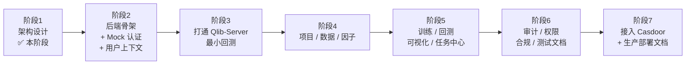

# 08 · 已知风险与七阶段路线图

## 1. 风险登记册（R1–R10）

| # | 风险 | 影响 | 可能性 | 缓解方案 | 触发阶段 |
|---|------|------|--------|----------|----------|
| **R1** | qlib-server 基础镜像 `continuumio/miniconda3:4.8.2` **只有 amd64**，开发机是 Apple Silicon | 无法启动 qlib-server | 高 | 默认 `platform: linux/amd64` + Rosetta 2；备选自建 arm64 镜像（`python:3.9-slim`）；最坏兜底用 QEMU | 阶段 3 |
| **R2** | qlib-server 官方 Dockerfile `pip install git+qlib`（当日 main）+ 2020 年基座，**今天很可能构建失败** | 拿不到可用的 qlib-server 镜像 | 高 | 自建 `qlib-server/Dockerfile`，钉死 `pyqlib==x.y.z` 与全部依赖（见 [06](./06-qlib-integration.md) §5）；锁定官方仓库 commit SHA | 阶段 3 |
| **R3** | socketio/engineio **双端协议代际不兼容**（4.x=EIO3，5.x=EIO4），握手直接失败 | worker 连不上 qlib-server | 中 | 两端都锁 4.x/3.x：server `4.4.0/3.11.2`，client `4.6.1/3.14.2`；阶段 3 第一步做 30 分钟连通性冒烟 | 阶段 3 |
| **R4** | 官方 online 模式依赖 **NFS 挂载**（`auto_mount` 需要 sudo/`nfs-common`） | worker 容器内 qlib.init 失败 | 中 | 用命名卷共享数据目录 + `provider_uri` 填本地路径 + `auto_mount: false`；阶段 3 实测 `D.instruments/D.features` 是否仍需本地文件；兜底 `cap_add: SYS_ADMIN` 或宿主机预挂载 | 阶段 3 |
| **R5** | `pyqlib 0.9.7` 与 qlib-server 的数据协议/内部 API 不匹配 | 数据请求报错 | 中 | 版本矩阵分档回退（0.9.7 → 0.8.x）；实测结论回写 [06](./06-qlib-integration.md) | 阶段 3 |
| **R6** | qlib 是**进程级单例**，不能并发处理不同 org 任务 | 任务串行、吞吐低 | 确定 | `QLIB_WORKER_CONCURRENCY=1`，靠横向扩 worker 副本并行；文档明示 | 阶段 3/5 |
| **R7** | Yahoo 数据下载在当前网络不可用 | 数据导不进来 | 中 | `bootstrap` 脚本三段式：官方下载 → 本地备份 zip → 指定 `STAGING_URL`；导入结果落授权台账 | 阶段 3/4 |
| **R8** | Next.js 15 + React 19 与 antd 5 的 peer 依赖冲突 | 前端装不上 | 中 | 若冲突锁 `react@18.3.1`（Next 15 支持）；`pnpm` 用 `peerDependencyRules.ignoreMissing` 兜底 | 阶段 2 |
| **R9** | Traefik 长连接超时掐断 Qlib WebSocket（生产） | 阶段 7 上线后任务全失败 | 中 | 静态配置关闭 read/write/responding 超时 + `passHostHeader` + 升级头 + sticky；列入切换清单与验证项 | 阶段 7 |
| **R10** | `jobs` 任务幂等与锁：worker 崩溃导致重复执行/死锁 | 结果重复、状态错乱 | 中 | `CacheProvider` 分布式锁 + DB 心跳租约 + `payload_hash` 幂等键 + 死信队列 + 阶段 5 的重试上限 | 阶段 5 |
| **R11** | **Qlib-Server 不支持 Redis 密码**：`qlib_server/utils.py` 的 `get_redis_connection()` 只有 `host/port/db`，无 `password` | 模式 B 指向带密码的外部 Redis 时 qlib-server 直接连不上 | 高 | ① 开发环境共用实例免密 + 仅内网暴露；② 模式 B **推荐**给 qlib-server 单独一个免密 Redis（内网、不对外），应用用带密码的外部 Redis，两者通过 `QLIB_SERVER_REDIS_HOST` 与 `CACHE_URL` 分开配置；③ 兜底：fork qlib-server 并给 `get_redis_connection()` 加 `password` 参数（改动极小，需记录补丁 commit） | 阶段 3 / 阶段 7 |

**降级策略总纲**：任何 qlib-server 风险（R1–R5）都**不阻塞阶段 2/4/5/6**——`ComputePort` 预留 `stub_compute` 实现（合成数据跑通状态机与前端），阶段 3 通过后再切 `qlib_compute`。这是可插拔架构的直接收益。

## 2. 七阶段路线图



> 每阶段固定交付：**目标 → 文件树 → 代码 → 启动命令 → 测试方法 → 已知风险 → 验收清单**，你确认后再进入下一阶段。

## 3. 阶段 2 预览（下一阶段）

### 目标
后端骨架跑起来：FastAPI 工厂、`pydantic-settings` 配置、五个 Port 的接口 + 各自至少一个实现、`MockAuthProvider`、`CurrentUser` 上下文、RBAC、Alembic 首个迁移（含全部表 + `dev-org`/`dev-user` seed）、审计写入、健康检查、架构约束测试。前端搭出布局骨架 + `AuthContext` + `useCurrentUser` + 首页风险提示。

### 文件树（新增）
```
backend/
├── pyproject.toml · uv.lock · alembic.ini · Dockerfile · .python-version
├── alembic/{env.py, versions/0001_init.py}
├── src/qqlab/
│   ├── main.py · config.py · container.py
│   ├── ports/{database,cache,message_queue,storage,auth,audit,compute}.py
│   ├── adapters/database/{postgres,sqlite}.py
│   ├── adapters/cache/{redis_cache,memory_cache}.py
│   ├── adapters/mq/{rabbitmq_mq,memory_mq}.py
│   ├── adapters/storage/{s3_storage,local_storage}.py
│   ├── adapters/auth/{mock_provider,casdoor_provider}.py   # casdoor 仅骨架+TODO
│   ├── adapters/audit/db_audit_writer.py
│   ├── api/{deps.py,router.py,v1/{auth,me,legal,system,admin}.py}
│   ├── core/{errors,rbac,tenant,logging,security,ratelimit}.py
│   ├── repositories/{base,org,user,project,audit}.py
│   ├── models/*.py · schemas/*.py
│   └── worker/{main.py,qlib_env.py}                        # 骨架，阶段 3 才接 qlib
└── tests/{architecture,unit,contract}/*.py
frontend/
└── src/{app/{layout,page,login,legal},contexts,components,lib}/**（骨架）
```

### 启动命令
```bash
docker compose up -d --build
docker compose logs -f backend
pytest -q tests/architecture tests/unit tests/contract
pnpm --dir frontend test          # Playwright 冒烟：首页风险提示 + 一键进入
```

### 测试方法
- L1 架构约束：扫描 import，断言业务层不碰 SDK。
- L2 租户隔离：seed 两个 org，跨 org 读写必须 404。
- L3 契约测试：同一组用例跑 `memory`/`redis`、`memory`/`rabbitmq`、`local`/`s3` 两套实现。
- 契约：`GET /api/v1/me` 返回 `dev-user` / `dev-org` / `[admin, researcher]`。

### 已知风险
R8（React/antd 版本）、`uvicorn --reload` 与 bind mount 在 macOS 上的文件事件（必要时 `WATCHFILES_FORCE_POLLING=true`）、SQLite 与 Postgres 的 JSONB/数组类型差异（契约测试统一走 Postgres）。

### 验收清单（阶段 2）
- [ ] `docker compose up -d --build` 一键全绿（qlib 相关服务不计入）
- [ ] 首页显示风险提示；`/login` 一键进入，顶栏显示 `dev-user @ dev-org`
- [ ] `GET /api/v1/me` 返回正确用户与角色；换 `profile=viewer` 后权限被拒
- [ ] 双 org 隔离测试通过；L1 架构测试通过
- [ ] `AUTH_PROVIDER` 切到 `casdoor` 时启动失败并给出清晰提示（骨架未实现）
- [ ] 所有外部地址来自环境变量，代码里 grep 不到 `localhost:` / IP
- [ ] `docker-compose.yml` 与 `docker-compose.prod.yml` 落到根目录

## 4. 阶段 3–7 一句话预览

| 阶段 | 一句话 | 关键交付 |
|------|--------|----------|
| 3 | 让 qlib-server 跑起来，跑通一个最小回测 | 自建 qlib-server 镜像、版本矩阵实测结论、`qlib_env.py`、Yahoo 数据导入、`ComputePort` 的 `qlib_compute` 实现、stub 实现对照 |
| 4 | 项目 / 数据 / 因子三个模块可用 | 项目 CRUD + 成员、数据源与**授权台账**、数据集导入与预览、因子表达式与校验 |
| 5 | 训练 → 回测 → 可视化 → 任务中心闭环 | 训练任务、回测任务（自定义费用）、ECharts 曲线与指标、任务列表/日志/取消/重试 |
| 6 | 合规与可验证性补齐 | 审计查询与导出、RBAC 全量覆盖、协议/风险提示/免责声明页、e2e 测试、README |
| 7 | 换上 Casdoor + 生产方案 | `CasdoorAuthProvider`、`docker-compose.prod.yml` 定稿、Traefik 与 Casdoor 配置说明、两种部署模式完整文档 |

---

**请确认阶段 1**（或指出需要调整的部分），确认后进入阶段 2。
